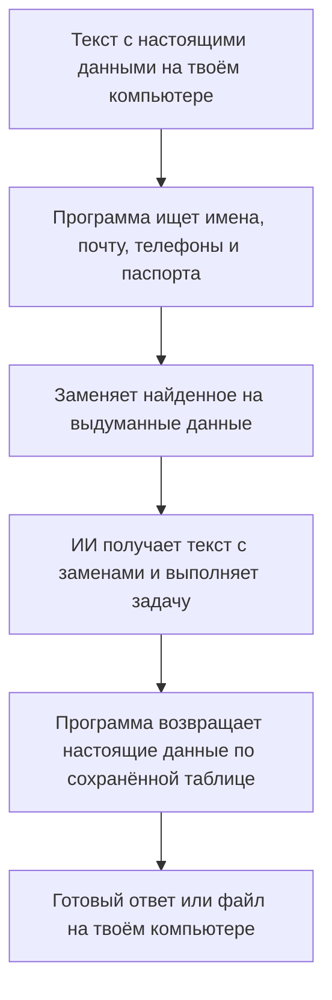

# PII Gateway — помощник, который прячет личные данные от ИИ

Представь: тебе нужно попросить ИИ написать письмо по документу. Но в документе есть настоящие имена, телефоны и номера паспортов. Отправлять всё это чужой компании не хочется.

**Наш проект заменяет найденные личные данные на выдуманные перед отправкой модели, а в готовом ответе возвращает настоящие.** Замены и обратная подстановка происходят на твоём компьютере.

Это прототип для хакатона. Сейчас он работает с текстом; поиск личных данных может ошибаться, поэтому для знакомства с проектом используй вымышленные примеры.

## Пример на одном письме

Допустим, нужно написать Анне напоминание о встрече. Ниже вымышленный пример, который показывает идею, а не результат конкретного запуска.

| Шаг | Что происходит |
| --- | --- |
| У тебя на компьютере | «Напиши Анне Сергеевне Ивановой. Почта: `anna@example.com`» |
| Перед отправкой | Программа заменяет имя и почту, а соответствие сохраняет у тебя |
| Модель получает | «Напиши Марии Павловне Соколовой. Почта: `person1@example.org`» |
| Модель отвечает | «Мария Павловна, напоминаем о встрече…» |
| Ты получаешь | «Анна Сергеевна, напоминаем о встрече…» |

Модели достаточно выдуманного имени, чтобы составить письмо. Таблица «кто на самом деле скрывается за этим именем» хранится локально и не включается в запрос к модели.

## Как это работает



Программа стоит между ИИ-помощником и моделью, которой он отправляет запросы. Такой посредник называется **gateway**, или шлюз. ИИ-помощник здесь — программа, которая может читать файлы, просить модель написать текст и сохранять результат.

Локальный поиск сочетает правила для номеров и адресов почты с моделью распознавания имён Natasha. Для обратной подстановки используется сохранённая таблица замен: генеративная модель не должна угадывать, кому принадлежали данные.

## Что уже умеет прототип

- Искать в тексте ФИО, email, российские телефоны и номера российских паспортов.
- Подставлять выдуманные значения или метки вроде `[PERSON_1]`.
- Возвращать сохранённые значения в ответ и учитывать поддерживаемые падежные формы имён.
- Повторно скрывать данные, когда помощник отправляет модели историю разговора или прочитанный из файла текст.
- Блокировать запрос при сбое фильтра и отклонять неподдерживаемые вложения.
- Ограничивать разрешённые файловые действия помощника. Для Linux есть отдельный режим изоляции, который закрывает помощнику прямой выход в сеть в обход шлюза.

В демонстрации помощник читает две карточки вымышленных клиентов и создаёт для каждого текст уведомления. Отчёт позволяет сравнить то, что получила модель, с результатом, сохранённым на компьютере.

## Где границы

**Прототип скрывает то, что смог распознать.** Он может пропустить необычное имя или сведения, по которым человека узнают косвенно: например, описание его работы. Даже после замены имени остальной текст отправляется выбранной модели.

Сейчас поддерживается текстовый обмен через OpenAI Chat Completions API — это формат запросов, который используют разные модели. Фото, сканы, PDF и другие вложения не входят в текущую версию. Совместимость с любым ИИ-приложением не гарантируется.

Таблица замен содержит исходные данные и остаётся чувствительным локальным файлом. Обычный запуск демо не включает изоляцию сети. Для неё нужен Linux и отдельная [настройка sandbox](bench/README.md). Поэтому успешное демо само по себе не означает, что можно безопасно отправлять любые документы.

## Как попробовать

Нужны **Python 3.12 или новее**, Git и [Ollama](https://ollama.com/) — программа для запуска модели на своём компьютере. В этом примере и модель, и шлюз работают локально. Первичная установка зависимостей и скачивание модели требуют интернета.

Для клонирования закрытого репозитория нужен доступ к нему и SSH-ключ GitHub. Если репозиторий уже скачан, пропусти `git clone` и перейди в его папку.

```bash
git clone git@github.com:Punk2013/hack-msu.git
cd hack-msu
python3 -m venv .venv
.venv/bin/pip install -e '.[dev]'
```

Запусти Ollama. Если она ещё не работает, выполни в отдельном терминале:

```bash
ollama serve
```

Скачай модель и запусти демонстрацию на вымышленных карточках из репозитория:

```bash
ollama pull qwen2.5:7b
bash scripts/demo.sh qwen2.5:7b
```

После успешного запуска скрипт напечатает два пути:

- **«Итоговые файлы»** — папка с уведомлениями. Открой их и проверь имена и контакты.
- **«Отчёт»** — файл `report.html`. Открой его в браузере и посмотри, какой текст получила модель и какие данные вернулись в ответ.

Каждый запуск создаёт отдельную временную папку и сохраняет её для проверки. Демо записывает полные запросы и ответы в локальные файлы, поэтому используй только вымышленные данные. Если появилось «Gateway не готов», путь к журналу ошибки будет в том же сообщении; проверь, что Ollama запущена и модель скачана.

## Для разработчиков

Основные части: `detect` ищет данные, `pseudo` заменяет и восстанавливает их, `vault` хранит соответствия, `gateway` обрабатывает запросы и ответы, `sandbox` ограничивает доступ помощника к сети и файлам.

```bash
.venv/bin/python -m pytest -q -rs
.venv/bin/ruff check
```

Тесты реальной Linux-изоляции на других системах пропускаются. Пропуск такой проверки не означает, что изоляция работает.

- [Устройство системы](docs/ARCHITECTURE.md)
- [Настройки, задачи и команды запуска](docs/PROJECT.md)
- [Сценарий проверки и ограничения MVP](docs/MVP_ACCEPTANCE.md)
- [Изоляция и проверка утечек](bench/README.md)
- [Правила совместной работы](AGENTS.md) и [задачи команды](https://github.com/Punk2013/hack-msu/issues)

Изменения принимаются через PR с ревью другого участника. Обсуждения — в Issues и PR.
