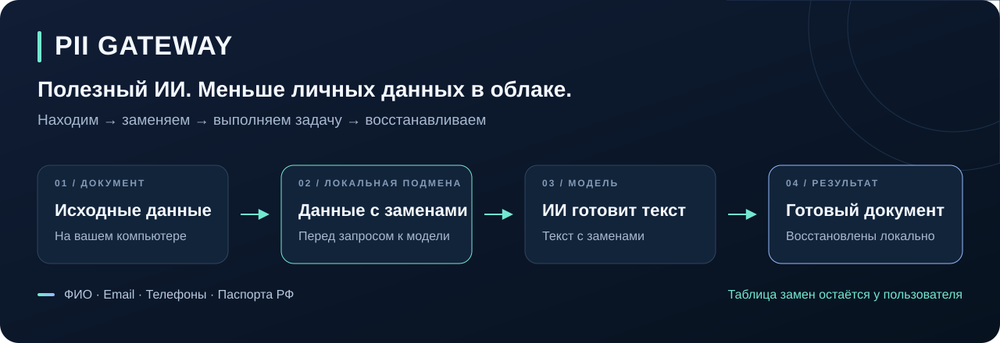
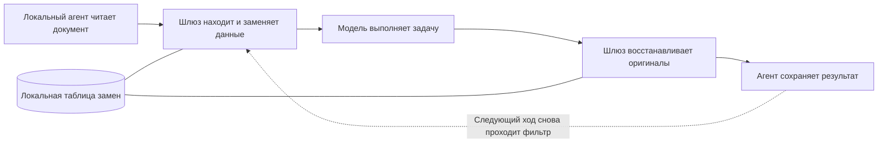

# PII Gateway

### Полезный ИИ. Меньше личных данных в облаке.



**Локальный шлюз, который заменяет найденные персональные данные перед отправкой ИИ-модели и возвращает исходные значения в готовый результат.** Модель составляет текст с выдуманными именами и реквизитами. Пользователь получает документ для настоящего адресата.

[Пример работы](#одна-задача-два-представления-данных) · [Что оценить](#что-оценить-в-проекте) · [Результаты проверок](#проверяемый-результат) · [Запуск](#попробовать-локально)

## Зачем это нужно

ИИ-помощник может подготовить письма клиентам, обработать обращения или составить уведомления. Для этого ему нужен смысл документа — а в том же документе лежат имена, телефоны и номера паспортов.

PII Gateway разделяет задачу и личные реквизиты. Перед каждым обращением к модели программа ищет поддерживаемые персональные данные и подставляет выдуманные значения. Таблица соответствий остаётся на компьютере пользователя. На обратном пути программа восстанавливает данные по этой таблице.

**Сценарий нашего демо:** помощник читает две карточки клиентов, готовит уведомления и сохраняет файлы с исходными именами и контактами. Пользователь может сравнить итоговые файлы с тем, что получила модель.

## Одна задача, два представления данных

Иллюстрация принципа на вымышленном примере:

| На компьютере пользователя | В запросе к модели |
| --- | --- |
| Анна Сергеевна Иванова | Мария Павловна Соколова |
| `anna@example.com` | `person1@example.org` |
| «Подготовь Анне Сергеевне напоминание о встрече» | «Подготовь Марии Павловне напоминание о встрече» |

Модель пишет: **«Мария Павловна, напоминаем о встрече…»**

После локального восстановления пользователь получает: **«Анна Сергеевна, напоминаем о встрече…»**

Выдуманные ФИО помогают сохранить естественный текст. В проекте также есть режим меток — например, `[PERSON_1]` — для сравнения и воспроизводимых проверок.

## Что оценить в проекте

| Инженерное решение | Практическая ценность | Где посмотреть |
| --- | --- | --- |
| **Обратимая подмена** | В итоговом документе сохраняются нужные пользователю реквизиты | [Движок замен](src/pii_gateway/pseudo/engine.py), [тесты восстановления](tests/pseudo/test_restore_integrity.py) |
| **Работа с русскими именами и падежами** | Поддерживаемые формы имени восстанавливаются в деловом тексте | [Морфология](src/pii_gateway/pseudo/morphology.py), [тесты движка](tests/pseudo/test_engine.py) |
| **Обработка каждого хода агента** | История разговора, прочитанные файлы и аргументы инструментов проходят через шлюз | [Адаптер протокола](src/pii_gateway/gateway/adapter.py), [файловый цикл](tests/integration/test_agent_file_loop.py) |
| **Контроль доступа на Linux** | Изолированному агенту доступен сетевой маршрут к шлюзу; vault остаётся вне его дерева файлов | [Sandbox](src/pii_gateway/sandbox/runner.py), [проверки изоляции](tests/sandbox/test_runner.py) |
| **Независимая проверка исходящих запросов** | Отдельный приёмник проверяет, что дошло до границы модели, и обнаруживает намеренную утечку | [HTTP-приёмник](src/pii_gateway/sandbox/upstream_spy.py), [сквозные тесты](tests/sandbox/test_full_gate.py) |

Здесь соединены локальное распознавание, обратимое преобразование текста, файловые действия агента и проверка сетевой границы. Восстановление выполняется программно по сохранённым соответствиям: языковой модели не нужно угадывать оригинал.

## Как устроен полный цикл



**В текущем MVP:** текстовые `.txt`/`.md`, ФИО, email, российские телефоны и паспорта; OpenAI Chat Completions API, обычные и потоковые ответы. Поиск работает локально: правила для реквизитов и модель распознавания имён Natasha. Для моделей можно использовать совместимый сервис или локальную Ollama.

[Архитектура и контракты](docs/ARCHITECTURE.md) · [Область применения и условия проверки](docs/MVP_ACCEPTANCE.md)

## Проверяемый результат

На синтетическом стенде агент работает с реальными файлами, настоящий шлюз обрабатывает запросы, а независимый HTTP-приёмник играет роль провайдера. Ответы приёмника заданы сценарием, поэтому результат можно повторить без облачного ключа.

| Проверка | Результат зафиксированного Linux-прогона |
| --- | --- |
| Скрытие данных, JSON и потоковый SSE | **0 из 8** размеченных исходных полей в запросах к приёмнику |
| Восстановление | **2 файла** точно совпали с исходными карточками |
| Положительный контроль: фильтр намеренно выключен | Приёмник обнаружил **все 8 из 8** исходных полей |
| Сбой детектора или хранилища | **0 запросов** к приёмнику, агент завершился с ошибкой |
| Полный набор сквозных сценариев JSON/SSE | **8 сценариев прошли** без пропусков |

Это измерения на конкретном синтетическом наборе, а не универсальный процент распознавания. Дата, версии, команды и подробные результаты — в [отчёте стенда](bench/REPORT-full-gate.md).

## Попробовать локально

Нужны **Python 3.12+**, Git и работающая [Ollama](https://ollama.com/). Для доступа к закрытому репозиторию нужен SSH-ключ GitHub. Если репозиторий уже скачан, перейди в его папку и начни с создания окружения.

```bash
git clone git@github.com:Punk2013/hack-msu.git
cd hack-msu
python3 -m venv .venv
.venv/bin/pip install -e '.[dev]'
ollama pull qwen2.5:7b
bash scripts/demo.sh qwen2.5:7b
```

Если Ollama ещё не запущена, выполни `ollama serve` в отдельном терминале. Установка зависимостей и модели требует интернета; в этом демо сама модель работает локально.

После успешного запуска скрипт печатает пути к **итоговым файлам** и **`report.html`**. Открой отчёт в браузере: он показывает запросы к модели и восстановленные ответы. Для демо используй синтетические карточки из репозитория — запросы и ответы сохраняются локально для просмотра.

Для запуска с Linux-изоляцией используй [инструкцию sandbox](bench/README.md). Обычный `demo.sh` показывает цикл обработки без OS-изоляции.

## Проверить реализацию

```bash
.venv/bin/python -m pytest -q -rs
.venv/bin/ruff check
```

Для проверок изоляции нужны Linux, bubblewrap и разрешённые namespaces. На остальных системах соответствующие тесты пропускаются.

[Код проекта](src/pii_gateway) · [Архитектура](docs/ARCHITECTURE.md) · [Настройки и команды](docs/PROJECT.md) · [Стенд и отчёт](bench/README.md) · [Разработка и ревью](https://github.com/Punk2013/hack-msu/pulls)
