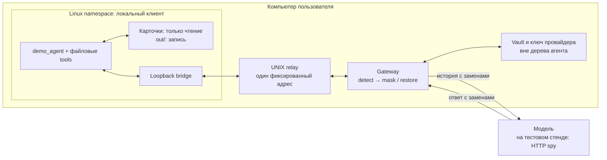

# Sandbox: материал для защиты

Срез 25.10.2026, main `5a1406d`. Техническая часть роли 4; исходные данные
во всех демонстрационных проверках синтетические.

## Что сказать за 30 секунд

Локальный клиент читает карточки клиентов. Перед каждым обращением к модели
gateway заменяет ФИО и реквизиты, а ответ восстанавливает локально. Это касается
и истории следующих ходов: записанные исходные данные снова проходят фильтр.
Linux sandbox ограничивает сеть клиента одним gateway и скрывает vault,
конфигурацию и код gateway. Отдельный HTTP-приёмник проверяет, что действительно
дошло до границы провайдера; намеренную утечку он обязан заметить.

## Схема для слайда



Исходный текст доступен локальному клиенту. Облачная модель получает историю
с заменами. Vault остаётся у gateway. На воспроизводимом стенде HTTP spy тоже
локальный, но принимает реальные HTTP-запросы независимо от audit log gateway.

## Что показали измерения

Каждая строка ниже выполнена отдельно для JSON и SSE. В SSE аргументы tools
передаются несколькими событиями, с разрезами внутри JSON-строки.

| Сценарий | Запросов на границе провайдера | Результат |
| --- | ---: | --- |
| Настоящий detect/pseudo/vault, realistic | 5 | 0 из 8 размеченных исходных полей; два файла восстановлены точно |
| Тот же цикл, фильтр выключен намеренно | 5 | Утечки в 4 запросах; найдены все 8 полей |
| Ошибка detector | 0 | Агент остановился, итоговых файлов нет |
| Ошибка vault | 0 | Агент остановился, итоговых файлов нет |

Пятый запрос подтверждает, что обе записи исполнены и агент продолжил работу.
Нулевое число запросов при отказе — отдельный результат `no_requests`;
штатный проход требует пяти запросов. При неподдержанном/недочитанном запросе
spy не выдаёт `clean`. В отчёте остаются счётчики и ID, без тел и ключей.

Отдельные namespace-тесты проверяют обходную сеть IPv4/IPv6 и UDP, для IPv4 —
также дочерний процесс; чтение/запись vault через пути и symlink, отсутствие ключей хоста.
Положительные контроли подтверждают, что запрещённые приёмники доступны с хоста.

## Что показать примерно за две минуты

1. Открыть `demo/clients/client1.txt` и `client2.txt`: по четыре размеченных поля.
2. Показать схему выше и запустить полный цикл:

   ```bash
   .venv/bin/python -m pytest tests/sandbox/test_full_gate.py -v -rs
   ```

   Ожидание для этой версии: **8 passed без SKIP**. Четыре прохода JSON/SSE
   с фильтром/положительным контролем и четыре инъекции ошибок.
3. Показать блокировку обхода сети и файлов:

   ```bash
   .venv/bin/python -m pytest tests/sandbox/test_runner.py -v -rs \
     -k 'real_namespace or namespace_'
   ```

   Любой SKIP означает, что соответствующую OS-изоляцию этот запуск не доказал.
4. Показать таблицу результатов и назвать ограничения. Длительность команд
   зависит от машины; перед защитой нужен пробный запуск с готовыми зависимостями.

## Откуда взяты результаты

- Linux разработчика: ядро 5.15.0-198-generic, Python 3.12.2, bubblewrap 0.6.1.
  Сквозные JSON/SSE-сценарии и команды: [REPORT-full-gate.md](REPORT-full-gate.md).
  Объединённый main `5a1406d` после #36/#39: **270 passed без SKIP**, 81.20 s,
  ruff чистый. Это собственный прогон автора стенда.
- Машина защиты, независимый повтор Punk2013: Arch, ядро 7.0.14-arch1-1,
  Python 3.14.6, bubblewrap 0.11.2. В [review #35](https://github.com/Punk2013/hack-msu/pull/35#pullrequestreview-5642953489)
  подтверждён JSON; в [review #39](https://github.com/Punk2013/hack-msu/pull/39#pullrequestreview-5643089082)
  — **8 сквозных JSON/SSE-сценариев и 263 теста всего, без SKIP**.
  Автор уточнил проверенный head #39 как `a8232b5` в комментарии PR.
- Исправления коллизий имён проверены отдельно: [повторное review #36](https://github.com/Punk2013/hack-msu/pull/36#pullrequestreview-5643095861),
  head `ebadc87`: 266 штатных тестов без SKIP и три внешние регрессии в профильном прогоне.
  Это другой срез кода; числа тестов разных срезов не складываются.

## Что ограничивает выводы

- В MVP четыре типа PII и текстовые `.txt`/`.md`; OCR, вложения и произвольные
  косвенные идентификаторы этим результатом не покрыты. Ноль совпадений восьми
  полей не означает, что детектор находит любые персональные данные.
- Провайдер стенда отвечает по заданному сценарию и копирует полученный текст.
  Сохранность данных и tool loop проверены; качество уведомлений живой LLM —
  отдельный прогон интегратора. Сценарий рассчитан на свежий vault.
- Нужен Linux с разрешёнными namespaces и bubblewrap. Уязвимости ядра,
  злонамеренный владелец хоста и произвольное кодирование утечек не проверены.
- `scripts/demo.sh` сам по себе не включает OS sandbox. Для показа живой модели
  вместе с изоляцией нужен согласованный запуск по [README.md](README.md).
  Пакетный захват и сравнение с OSS baseline здесь не заявляются выполненными.
